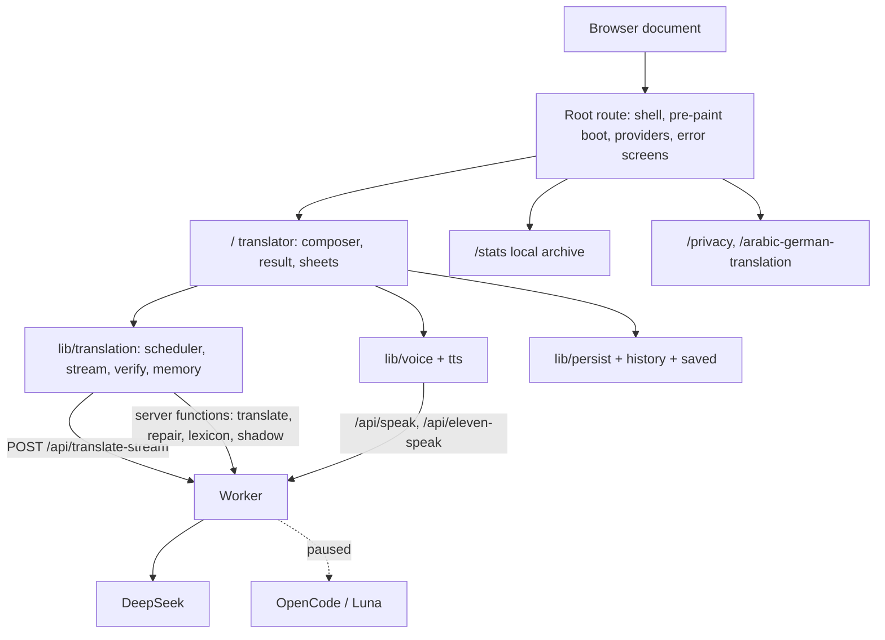

# Architecture Overview

Status: **Verified** against the source on 2026-11-07. Diagrams are syntax-reviewed but were not
rendered in this environment (no Mermaid CLI).

## Shape

A TanStack Start application with one server-rendered document shell and client-side routing. The
translator is the root screen; secondary routes share the shell. Server functions and API routes
own every secret and every provider call.

## Layers and dependency direction

1. **Routes / components** compose UI and own interaction state. They do not construct prompts or
   talk to providers.
2. **Domain libraries** (`lib/translation`, `lib/voice`, `lib/stats`) are framework-light and mostly
   pure. They may depend on types and validators, not on React routes.
3. **Persistence** (`lib/persist`, `history`, `saved`, memory) validates everything read from the
   device. Preferences, session, archive and saved phrases are separate concerns with separate
   keys.
4. **Server boundary** (`routes/api/*`, `*.functions.ts`, `engine.server.ts`, `providers/*`) reads
   environment secrets, enforces same-origin and bounded input, streams output, and classifies
   failures.

Dependency direction is inward: routes → domain → types/validators. The domain never imports a
route. Provider modules are server-only.

## Rendering and navigation

- The root route renders `<html>` (shell), the boot scripts, `HeadContent`, `<Outlet />` and the
  error/not-found screens.
- Internal links use the router; navigation does not request a new document. View transitions are
  progressive enhancement.
- Route components unmount on navigation. Continuity comes from (a) the persistent root shell and
  (b) `persist.remembered()` seeding the translator's first render, plus the session and its cached
  result.
- Details and measured evidence: `docs/architecture/navigation-and-lifecycle.md`.

## State ownership

| State | Owner | Lifetime |
| --- | --- | --- |
| Draft, pair, style, dialect, brain | `src/routes/index.tsx` | Route mount; mirrored to session/prefs |
| Translation phase/result/cache | `lib/translation/useTranslator` | Route mount; settled results also in device memory |
| Theme | `lib/theme` store | Tab + storage |
| Interface locale | `lib/i18n` store | Tab + storage |
| History / stats | `lib/history`, `lib/stats` | Device storage; stats derived |
| Saved phrases | `lib/saved` | Device storage |
| Voice preferences | `lib/voice` preferences | Device storage (versioned migration) |

## Error handling

- Route-level: `ErrorScreen` and `NotFoundScreen` are product surfaces; no stack traces to people.
- Translation-level: `useTranslator` maps error kinds to phases, preserves the last good result,
  retries transient failures once, and stays quiet for live-rate limits.
- Server-level: same-origin rejection, rate limit, bounded JSON, provider error classification,
  cancellation treated as a quiet end rather than an error.
- Last resort: a standalone offline/error page generated for the service worker.

## External boundaries

- **DeepSeek** writes translations and performs repair/review. Active.
- **OpenCode / Luna** is implemented but paused (`LUNA_ENABLED = false`); no request may silently
  use it while paused.
- **Speech providers** are called only by server routes; keys never reach the browser.
- **Google Fonts** are self-hosted; there is no font CDN in the critical path.

## Structural notes and debt

`src/routes/index.tsx` is large (~1,060 lines) because it composes the whole translator, boot
restore, voice, shadow and sheets. Behaviour is delegated to hooks and libraries, but the route is
still the main coordination point. Splitting it further is recorded as debt, not done speculatively;
see `docs/audits/technical-debt.md`.
