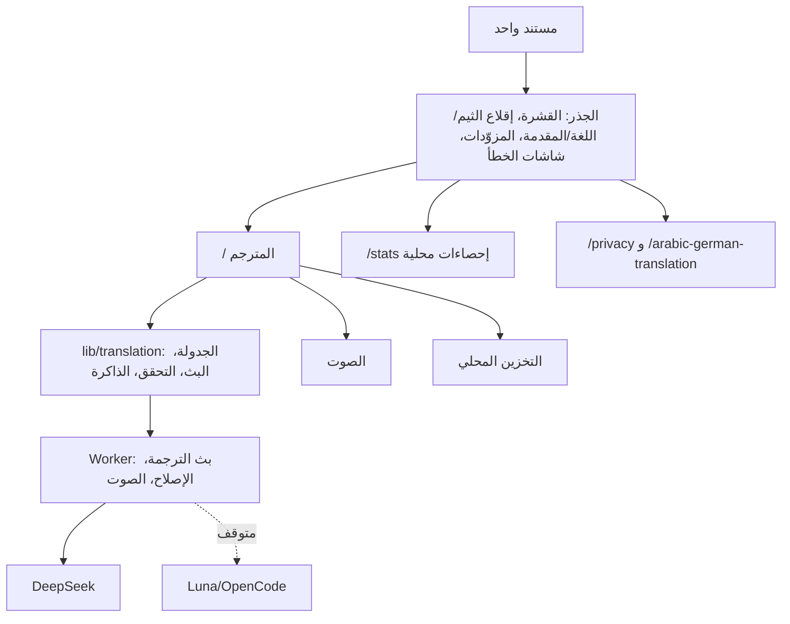

# تقرير التدقيق النهائي — Deep Meaning Translate (today)

**التاريخ:** 7 نوفمبر 2026  
**الفرع:** `freebuff/a732ac8a763f1d05fdfa9d70`  
**النطاق:** المنتج، المعمارية، الموثوقية، تجربة الاستخدام، إمكانية الوصول، الأمان، الاختبارات، والتوثيق.  
**حالة التسليم:** تغييرات محلية موثّقة ومُختبرة. لم يُنفَّذ commit أو push أو نشر، ولم تُغيَّر أي بيانات إنتاج.

---

## ملخّص تنفيذي

المشروع لم يكن «متجرًا تجريبيًا» يحتاج إعادة بناء. كان منتجًا ناضجًا فعلاً: بوابات نظيفة، 289 اختبارًا ناجحًا قبل التغيير، 51 زوج ألوان يمرّ بمعيار WCAG، وبناء إنتاجي ناجح. المشكلة الحقيقية كانت في **الاستمرارية**: التطبيق كان يبدو وكأنه يُعاد بناؤه عند العودة من شاشة أخرى، وكانت الترجمة المستعادة تختفي وتُطلب مرة ثانية، وكانت هناك احتمالات لوميض لوني أثناء الانتقال.

تمّ التعامل مع هذه المشكلات كعيوب دورة حياة وحالة، لا كمسألة تجميل:

1. **الترجمة المستعادة كانت تُخزَّن بمفتاح زوج لغوي مختلف عن الزوج المعروض.** أُصلح الجذر بدالة نقية `restorePlan()` تجعل الجلسة صاحبة الزوج، وتُمرّر النتيجة المستعادة إلى `useTranslator` لتُعرض فورًا دون طلب.
2. **المسار كان يُعاد تركيبه بحالة فارغة.** أُضيفت ذاكرة تبويب (`persist.remembered()`) تُغذّي الحالة الابتدائية، فتُرسم المسودة والترجمة في أول إطار.
3. **اللون:** المستند لم يكن يملك خلفية صريحة، وطبقة الانتقال لم تكن تحمل خلفية، ومدة اللقطتين كانت غير متساوية. أُصلح ذلك، وأُضيف مزامنة `theme-color` لكل المسارات.
4. **الاتجاه قبل الرسم:** أُضيف `LOCALE_BOOT` ليضبط `lang`/`dir` قبل أول إطار.

النتيجة المقاسة في حزمة الإنتاج: العودة من `/stats` إلى `/` تُظهر المسودة والترجمة بعد **~64 مللي ثانية**، مستند واحد فقط، دون أي طلب ترجمة، وبخلفية واحدة ثابتة في كل الإطارات المفحوصة. أُجريت 17 عملية فحص داكنة ضمن 14 دورة (8 عادية و6 سريعة)، و8 دورات فاتحة، دون خطأ، مع فحوص تنقّل أثناء انتقال الثيم.

ما لم يُثبت: **جودة الترجمة اللغوية** (لا مفاتيح مزوّد)، واختبارات E2E بايثون (Playwright غير متاح هنا)، واختبارات الأجهزة الحقيقية، والتدقيق الأمني التنافذي، وفحص ثغرات الحزم. هذه ليست «نجاحات»، بل حدود مُعلنة.

---

## 1. المنهجية والأدلة

- فحص المستودع الفعلي، وليس افتراضات عن التقنية. discovered stack: TanStack Start/Router، React 19، Vite 8، Tailwind 4، TypeScript 6، Zod، Vitest، vite-plugin-pwa.
- تشغيل البوابات قبل التغيير وبعده، وفحص المخرجات.
- تتبّع مسارات التنفيذ: البوابة، الجذر، الراوتر، جدولة الترجمة، البث، التحقق، التخزين، الخدمات الصوتية.
- تجارب وقت تشغيل في متصفح سحابي على خادم التطوير وعلى محوّل الإنتاج (`scripts/serve-build.mjs`).
- تصنيف الأدلة: **VERIFIED / OBSERVED / SUSPECTED / NOT_VERIFIED / NOT_APPLICABLE**.
- لم تُكتب أي وثيقة عن قدرة قبل تتبّع تنفيذها. ولم يُنسب نجاح لاختبار لم يُشغَّل.

---

## أ. تقييم نضج المشروع

لا نستخدم نسبًا أو درجات مُختلقة. التقييم أدناه نوعي ومبني على دليل قابل لإعادة الفحص.

| المجال | التقييم | الأساس | الفجوة المتبقية |
| --- | --- | --- | --- |
| المعمارية | قوية مع دين تقني واحد | حدود واضحة: الواجهة لا تبني الأوامر ولا تتحدث إلى المزوّد؛ الأسرار على الخادم؛ مصدر واحد لكل مسؤولية | `src/routes/index.tsx` كبير (~1060 سطرًا) |
| الصحة الوظيفية | قوية في المسارات المُختبرة | 300 اختبار ناجح، واختبارات انحدار للاستعادة والتنقل | لا تغطية لجميع حالات المزوّد الحقيقية |
| جودة الترجمة | **فجوة** | فحوص حتمية فقط (أرقام، روابط، إيموجي، أسماء، بنية، ترقيم) | لا مفاتيح، ولا مدونة مراجعة بشرية |
| التنقل والعرض | قوية بعد الإصلاح | مستند واحد، خلفية ثابتة، استعادة فورية، 17/17 داكنة + 8/8 فاتحة | لا تسجيل فيديو/بكسل |
| اتساق الواجهة | قوية مع فجوة بصرية | رموز دلالية، 51 زوج تباين، مكوّنات موحّدة | لا اختبار انحدار بصري |
| الأداء | كافٍ | قياس زمن العودة، مستند واحد، لا طلبات مكررة | لا Profiling ولا قياس ذاكرة طويل |
| الأمان | كافٍ |same-origin، Zod، حدود جسم، أسرار خادم، لا نص في السجلات | لا Pen-test ولا `npm audit` |
| الاختبارات | كافٍ | 300 اختبار، بوابات صارمة | E2E خارج CI، لا اختبار بصري |
| قابلية الصيانة | كافٍ | أنواع، حدود، توثيق جديد | حجم الراوتر، تكرار محتمل في التنسيق |
| التوثيق | قوية (جديدة) | فهرس، مصادر حقيقة، بوابة روابط | تحتاج مراجعة دورية مرتبطة بالكوميتات |

**الخلاصة:** المشروع أقرب إلى «منتج جاد يحتاج صقل استمرارية وتوثيق» من «نموذج أولي يحتاج إعادة كتابة». النضج الحقيقي الآن مدعوم باختبارات انحدار ونظام معرفة، لا بانطباع.

---

## ب. سجل العيوب والإصلاحات

### D1 — الترجمة المستعادة تختفي وتُطلب مرة ثانية (P1)

- **العَرَض:** العودة إلى `/` تُعيد المسودة لكن ليس الترجمة، ويُعاد طلب `/api/translate-stream`.
- **الجذر:** عند الإقلاع كانت الذاكرة تُهيَّأ بمفتاح **التفضيلات** بينما الحالة المرئية تحتفظ بزوج الجلسة. مفتاح الطلب لا يطابق المفتاح المُهيَّأ أبدًا.
- **الإصلاح:** `restorePlan(session, prefs)` دالة نقية: الجلسة تملك النص والزوج والنمط والنتيجة؛ التفضيلات تملأ اللهجة والدماغ فقط؛ `requestSource` يصبح `auto` عند تعارض قوي في نظام الكتابة. و`useTranslator` يقبل `restored` ويبدأ بحالة `COMPLETE` ومفتاح مُلتزم.
- **الملفات:** `src/lib/translation/restore.ts` (جديد)، `src/routes/index.tsx`، `src/lib/translation/useTranslator.ts`، `src/lib/persist.ts`.
- **الاختبارات:** `restore.test.ts` (4 حالات)، وحالة «نتيجة محمولة تُعرض فورًا دون طلب» في `useTranslator.test.tsx`.
- **التحقق:** اختبارات ناجحة + مشاهدة في حزمة الإنتاج: المسودة والترجمة في أول رسم، ولا طلب POST.

### D2 — إعادة تركيب المسار تُظهر مترجمًا فارغًا (P1)

- **العَرَض:** `/` → `/stats` → `/` يعرض حقلًا فارغًا قبل قراءة التخزين؛ إحساس «التطبيق يُعاد بناؤه».
- **الجذر:** مكوّنات المسارات تُفكَّك عند التنقل، و`useState` يبدأ فارغًا، والاستعادة تحدث في `useEffect` بعد الرسم.
- **الإصلاح:** ذاكرة على مستوى الوحدة في `persist.ts` (`rememberedPrefs`/`rememberedSession`)، و`persist.remembered()` يُغذّي الحالة الابتدائية. على التحميل البارد تكون الذاكرة فارغة، فيبقى SSR والـ hydration متطابقين.
- **الاختبارات:** حالة «يتذكّر آخر قيم التبويب» في `storage.test.ts`.
- **التحقق:** العودة في الإنتاج: الحقل والترجمة بعد ~64 مللي ثانية.

### D3 — احتمال وميض لوني أثناء الانتقال (P2)

- **الجذر:** `html` بخلفية شفافة و`body` يحمل اللون؛ طبقة `::view-transition` بلا خلفية؛ مدة اللقطتين 180/260 مللي ثانية.
- **الإصلاح:** خلفية صريحة لـ`html`، `scrollbar-gutter: stable`، خلفية للطبقة، تطابق المدة والتخفيف عند 220 مللي ثانية، و`mix-blend-mode: normal`.
- **الدليل:** كل إطار مفحوص أظهر `rgb(18, 16, 15)` لكل من `html` و`body`.
- **الملف:** `src/styles.css`.

### D4 — لون واجهة المتصفح قد يبقى قديمًا في `/stats` (P2)

- **الجذر:** `theme-color` كان يُحدَّث فقط من `ThemeToggle`، و`/stats` لا يعرضه.
- **الإصلاح:** `syncThemeColor()` يقرأ `--background` المُحسوب ويحدّث كل `meta[name=theme-color]`؛ يُستدعى من `apply()` ومن تأثير الجذر. يتجاهل القيمة الفارغة (بيئة jsdom) بدل مسح الوسم.
- **التحقق:** الوضع الداكن على `/stats`: `#12100f`، والفاتح: `#f7f3ec` مطابقًا لـ`--background` المحسوب. أُجريت 8 دورات فاتحة دون خطأ.

### D5 — أول رسم قد يكون إنجليزيًا LTR قبل العربية RTL (P2)

- **الإصلاح:** `LOCALE_BOOT` يتحقق من اللغة المحفوظة، يرجع إلى لغة المتصفح، ويضبط `lang`/`dir` قبل الرسم. يُبنى من نفس `normalizeLocale` التي يستخدمها React، فلا يمكن أن يختلفا. فشل التخزين لا يمنع الرجوع إلى لغة المتصفح.
- **الاختبارات:** `localeBoot.test.ts` (4 حالات).
- **الحد:** **نصوص الواجهة** ما زالت تُترجم بعد hydration؛ SSR يصدر الإنجليزية. هذه فجوة مُسجّلة (TD2)، لا إنجاز.

### D6 — واجهة تحقق خادم مهجورة (P3)

- **الإصلاح:** `.inputValidator()` → `.validator()` في `translate.functions.ts`، `lexicon.functions.ts`، `shadow.functions.ts`. لا تغيير في المخطط أو السلوك.

### D7 — قاعدة تخزين خطوط من CDN ميتة (P3)

- **الإصلاح:** حُذفت من `vite.config.ts`؛ الخطوط مستضافة ذاتيًا. pre-cache بقي 37 ملفًا.

### D8 — Service Worker قديم في بيئة معاينة (بيئة، ليس عيب منتج)

عارض إنتاجي سجّل عامل الخدمة على نطاق معاينة. بعد تبديل الخادم إلى بناء تطوير، قدّم العامل **قشرة إنتاج قديمة**، فرفع التنقل التالي حدود خطأ للمسار. بعد إلغاء التسجيل ومسح الكاش لم يتكرر في 25 فحصًا ولا في معاينة إنتاج جديدة مع `?sw=off`. موثّق في ADR 0004؛ لا يُحتسب عيبًا في المنتج، لكنه يفسّر أهمية عدم تشخيص عيب من تشغيل واحد.

---

## ج. تقرير الاستقرار البصري والتنقل

### لماذا كان يبدو أن التطبيق يُعاد بناؤه؟

سببان مستقلان اجتمعا في إحساس واحد:

1. **الجلسة كانت تُستعاد بالنص فقط، بينما مفتاح الترجمة يُبنى بزوج مختلف.** النتيجة: مسودة تعود، ترجمة تختفي، وطلب جديد يُدفع ثمنه.
2. **المسار يُفكَّك فعليًا عند مغادرته، والحالة الابتدائية فارغة.** حتى مع وجود الجلسة في التخزين، أول إطار بعد العودة كان فارغًا، ثم تُقرأ القيم في تأثير لاحق. هذا هو «إعادة البناء» المرئي.

### لماذا كان الوميض اللوني ممكنًا؟

- `html` لم يكن يملك خلفية، والخلفية كانت على `body`. أثناء cross-fade تكون اللقطتان شبه شفافتين في معظم المدة، فيظهر قماش المتصفح.
- طبقة `::view-transition` لم تكن تحمل لونًا.
- مدة الخروج 180 مللي ثانية والدخول 260 مللي ثانية، فكانت إحدى الصفحتين مهيمنة بصريًا.

### ما الذي تغيّر؟

- الجلسة صاحبة الزوج، والنتيجة المستعادة تُمرَّر إلى الخطاف وتُعرض فورًا.
- ذاكرة التبويب تُغذّي الحالة الابتدائية، فتكون العودة فورية.
- المستند يملك لونه، والطبقة تحمل الخلفية، والمدتان متساويتان.
- `theme-color` يُزامَن لكل المسارات.
- `LOCALE_BOOT` يضبط الاتجاه قبل الرسم.

### ما الذي يبقى محفوظًا الآن؟

الهيكل الجذري، الثيم، اللغة، المزوّدات، المسودة، الزوج، النمط، اللهجة، الدماغ، والترجمة المستقرة. أما الأوراق المفتوحة والتنبيهات المؤقتة فتبقى محلية للمسار — وهذا سلوك مقصود.

### الأدلة المقاسة

| الفحص | النتيجة | الدليل |
| --- | --- | --- |
| مستند واحد | PASS | `navigation entries === 1` قبل وبعد |
| العودة تعرض المسودة والترجمة | PASS | ~64 مللي ثانية في حزمة الإنتاج |
| لا طلب ترجمة عند العودة | PASS | لا طلبات غير GET في دورة التنقل |
| ثبات الخلفية | PASS | كل الإطارات: `rgb(18, 16, 15)` |
| دورات متكررة وسريعة | PASS | 17/17 داكنة + 8/8 فاتحة دون حدود خطأ |
| لون واجهة المتصفح | PASS | `#12100f` داكن و`#f7f3ec` فاتح على `/stats` |

**ملاحظة أمانة:** لوحظ حدّان لخطأ المسار بعد تبديل البناء/الخادم/المعاينة (أحدهما مع Service Worker قديم، والآخر في تبويب جديد). لم يتكررا في 25 فحصًا نظيفًا ولا في فحوص الانتقال الفوري. لا نقدّمهما كعيب منتج مُثبت، ولا نخفي أنهما حدثا؛ مسجّلان كـTD13.

---

## د. المعمارية النهائية

**قرارات جوهرية:**

- **ADR 0001:** مستند واحد وقشرة دائمة، مع استعادة صريحة لما تفقده المسارات.
- **ADR 0002:** الجلسة تملك زوجها عند الاستعادة؛ التفضيلات تملأ الفراغات فقط.
- **ADR 0003:** المستند يملك اللون قبل الرسم؛ طبقة الانتقال تحمل الخلفية.
- **ADR 0004:** مسجّل Service Worker واحد، احتياطي offline، ومنفذ `?sw=off` للتشخيص.

**حدود المسؤولية:** الواجهة تركّب ولا تبني الأوامر؛ `lib/translation` هي مصدر معرفة الطلب والتحقق؛ الخادم يملك المفاتيح والمزوّدات؛ `persist` يملك التحقق من التخزين؛ `history`/`stats` مصدر واحد للإحصاءات.

**دين معماري معروف:** `index.tsx` كبير. لم يُقسَّم عشوائيًا لأن التقسيم بلا اختبارات سلوكية يخاطر بالاستمرارية التي أصلحناها. مسجّل كـTD7 مع خطة استخراج Hook لاحقًا.

---

## هـ. جرد التوثيق

| الملف | الغرض | كيف يُستخدم |
| --- | --- | --- |
| `AGENTS.md` | عقد التشغيل للبشر والوكلاء | يُقرأ أولًا؛ يحدد مصادر الحقيقة وسير العمل والقواعد الصارمة |
| `README.md` | مقدمة المنتج، التشغيل، البوابات، الحدود | نقطة الدخول للمطور الجديد |
| `PROJECT_CONSTITUTION.md` | دستور المنتج والهندسة | يمنع الانحراف عن الهوية والمبادئ |
| `PROJECT_MAP.md` | خريطة المستودع والاعتماديات | قبل أي تغيير هيكلي |
| `DEFINITION_OF_DONE.md` | معايير الإنجاز الموضوعية | قبل اعتبار أي إصلاح/ميزة/إصدار مكتملًا |
| `DOCUMENTATION_INDEX.md` | فهرس كل وثيقة وحالتها وترتيب السلطة | عند التعارض أو البحث عن مصدر الحقيقة |
| `docs/product/vision-and-scope.md` | الرؤية، المستخدمون، غير الأهداف، المصطلحات | لتقرير ما إذا كانت الميزة تنتمي للمنتج |
| `docs/product/capabilities-and-journeys.md` | القدرات والرحلات بثلاث مراحل | عند تغيير أي تدفق مستخدم |
| `docs/architecture/overview.md` | المعمارية، الطبقات، تدفق البيانات | بداية أي تغيير بنيوي |
| `docs/architecture/navigation-and-lifecycle.md` | التنقل، الإقلاع، الثيم، الأدلة | عند لمس الراوتر أو الثيم أو الاستعادة |
| `docs/architecture/state-and-persistence.md` | المفاتيح، التحقق، الذاكرة، الأرشيف | عند تغيير حالة أو تخزين |
| `docs/architecture/api-and-providers.md` | العقود، البث، المزوّدات، الأخطاء | عند تغيير نقطة أو مزوّد |
| `docs/architecture/decisions/0001..0004` | قرارات معمارية مؤرخة | عند سؤال «لماذا؟» أو تغيير القرار |
| `docs/translation/pipeline.md` | مسار الترجمة كاملًا | عند تغيير السلوك أو التحقق |
| `docs/translation/registers-and-languages.md` | النبرة، اللهجات، الاتجاه | عند تغيير الأوامر أو اللغات |
| `docs/translation/evaluation.md` | التقييم والمدونة والحدود | قبل أي ادعاء جودة |
| `docs/design/system.md` | الرموز، الخطوط، المكوّنات، الحالات | عند تغيير الواجهة |
| `docs/design/motion-and-accessibility.md` | الحركة، التركيز، التباين، RTL | عند إضافة حركة أو عنصر تفاعلي |
| `docs/quality/testing.md` | البوابات، البنية، ما لا يُغطّى | عند كتابة اختبار أو الإبلاغ عن نتيجة |
| `docs/quality/navigation-regression.md` | معايير القبول وسيناريو E2E | عند لمس التنقل |
| `docs/security/privacy-and-threat-model.md` | الثقة، الأسرار، السجلات، الاحتفاظ | عند لمس الخادم أو الأوامر أو التخزين |
| `docs/operations/development-and-release.md` | التطوير، البناء، النشر، التشخيص | عند البناء أو الإصدار أو التحقيق |
| `docs/audits/2026-11-07-baseline-and-repairs.md` | خط الأساس والعيوب والأدلة | سجل التدقيق |
| `docs/audits/technical-debt.md` | سجل الدين التقني | حي يُحدَّث |
| `docs/audits/final-report-ar.md` | هذا التقرير | التسليم النهائي |

**وثائق تاريخية لا تُعتبر مرجعًا:** `AUDIT.md`، `تقرير-الترقية.md`، `تقرير-الترقية-٢.md`، `تقييم-التطبيق.md`. قد تصف سلوكًا لم يعد قائمًا؛ لا تُستخدم لتبرير تغيير.

---

## و. القيود والمخاطر المتبقية

1. **جودة الترجمة غير مُثبتة:** لا مفاتيح مزوّد، ولا مدونة مراجعة بشرية. الفحوص الحتمية تلتقط فقدان الأرقام/الروابط/الأسماء، ولا تلتقط جملة سليمة المعنى خاطئة الدلالة.
2. **SSR غير مُعرَّب:** الاتجاه واللغة قبل الرسم، لكن نصوص الواجهة تُترجم بعد hydration. (TD2)
3. **E2E خارج CI:** سيناريو التنقل الجديد مكتوب، لكن Playwright لم يكن متاحًا، فلم يُشغَّل هنا. (TD3)
4. **لا اختبار بصري:** لا لقطات/فروقات بكسل في البوابات. (TD4)
5. **محدودية المعدّل محلية للعملية:** ليست حماية على مستوى النشر. (TD5)
6. **لا تدقيق حزم:** `npm audit` لم يُشغَّل ضمن هذه الجولة. (TD6)
7. **الأداء غير مُقاس تحت الحمل:** لا Lighthouse ولا قياس ذاكرة طويل. (TD9)
8. **حدّان مؤقتان للمسار** لوحظا بعد تبديل البناء/الخادم/المعاينة، ولم يتكررا في 25 فحصًا نظيفًا. مصنّفان SUSPECTED كأثر بيئة معاينة (TD13)، لا كعيب منتج مُثبت.
9. **مصفوفة الأجهزة:** متصفح Chromium سحابي واحد؛ لا أجهزة حقيقية ولا قارئ شاشة. (TD12)
10. **Service Worker في المعاينات:** بيئة معاينة قد تسجّل عاملًا وتُظهر قشرة قديمة؛ استخدم `?sw=off`. (TD8)

---

## ز. مصفوفة التحقق النهائية

| المجال | الاختبار المُنفَّذ فعليًا | النتيجة | الدليل |
| --- | --- | --- | --- |
| البناء الإنتاجي | `npm run build` | PASS | Worker + headers، exit 0 |
| الأنواع | `npm run typecheck` | PASS | 0 أخطاء |
| Lint/تنسيق | `npm run lint -- --max-warnings 0` | PASS | 0 تحذيرات |
| الاختبارات | `npm run test` | PASS | 300 ناجح، 4 متجاوز، 50 ملفًا |
| التباين | `npm run check:contrast` | PASS | 51/51 |
| PWA | `node scripts/check-pwa.mjs` | PASS | 37 ملفًا |
| التنقل | 25 فحصًا داكنًا/فاتحًا على حزمة الإنتاج | PASS | مستند واحد، ~64 مللي ثانية، لا POST |
| ثبات الخلفية | أخذ عينات إطارية | PASS | `rgb(18, 16, 15)` فقط |
| لون المتصفح | `/stats` داكن + فاتح | PASS | `#12100f` / `#f7f3ec` |
| جودة المزوّد | طلب حقيقي بمفاتيح | NOT_VERIFIED | لا مفاتيح |
| E2E بايثون | `navigation_stability.py` | NOT_VERIFIED | Playwright غير متاح |
| أمان الحزم | `npm audit` | NOT_VERIFIED | لم يُشغَّل |
| أجهزة حقيقية | قارئ شاشة/لوحة مفاتيح | NOT_VERIFIED | لا جهاز |

---

## الخلاصة

أصبح المنتج أكثر ثباتًا في المكان الذي يشعر به المستخدم فعلاً: العودة إلى المترجم لم تعد تبدو كإعادة تشغيل، والترجمة التي دفع ثمنها لا تختفي، والخلفية لا تتغيّر بين الشاشات، والاتجاه صحيح قبل أول إطار. والأهم أن هذه السلوكيات أصبحت محميّة باختبارات، لا بثقة.

ما لم يُثبت مكتوب صراحة. لا نعلن «خاليًا من الأخطاء»، ولا نمنح درجة رقمية بلا منهج. الحكم النهائي: **منتج جاد، ناضج هندسيًا، مع فجوة جودة لغوية تحتاج مفاتيح ومراجعة بشرية، وفجوة تغطية E2E/بصرية تحتاج CI.** التوثيق الجديد يجعل هذه الحدود جزءًا من المشروع، لا شيئًا يُنسى.
