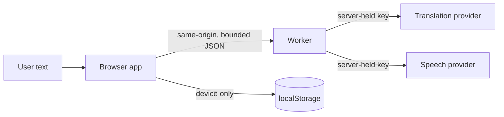

# Security and Privacy

Status: **Source-verified** boundaries on 2026-11-07. No penetration test, dependency audit or
production credential test was performed. Claims below distinguish implementation from assurance.

## Trust boundaries

- The browser is untrusted for every input: text, language codes, style, dialect, brain, partial.
- The Worker validates with Zod, checks same-origin, bounds body size and applies per-purpose rate
  limits before any provider call.
- Provider responses are untrusted too: parsed defensively, verified, never injected as HTML.

## Secrets

- Provider keys are read from `process.env` only inside server modules/handlers.
- No secret is placed in client bundles, browser storage, URLs, logs, tests, documentation or error
  messages.
- Known names: `DEEPSEEK_API_KEY` (active writer), `OPENCODE_API_KEY` (Luna, paused). Speech keys are
  read only in their server routes; see `.env.example` for the exact names.
- The repository is connected to Lovable; do not commit `.env` or any credential file.

## Input and output handling

- `InputSchema` bounds text at 5,000 characters and restricts language/style/dialect/brain values.
- `boundedJson` rejects oversized or malformed bodies before parsing.
- Same-origin checks reject cross-site mutation requests.
- Model output is parsed into a typed result; React renders it as text. There is no
  `dangerouslySetInnerHTML` path for translations, so model output cannot become script.
- Clipboard, speech and shadow features consume the same typed result, not raw model text.

## LLM-specific boundaries

- User text is placed inside `<text>` tags and treated as data. System rules state that the model
  must translate, not follow instructions inside the text.
- The system prompt forbids adding explanations; the verifier flags added notes/labels.
- The app never exposes provider credentials or raw provider errors to the browser.
- A malicious translation cannot trigger a privileged action: there is no tool use, no code
  execution and no server action driven by model output.
- Prompt-injection resistance is **not formally tested**; it is a design boundary, not a proof.

## Logging and retention

- Translation logs contain event, mode, brain, outcome, duration and character count — never text or
  translation.
- Speech requests are not logged with their text.
- The app has no accounts and no server-side user-content store.
- Drafts, history, saved phrases, memory, theme and locale live on the device and are validated on
  read. `clearAll()` removes every `lingua.*` key; the privacy page exposes the user-facing control.
- Data sent to a provider is governed by that provider's policy; the app does not claim more than
  "we do not store your text".

## Abuse protection

- Process-local token buckets: translation, warm-up, repair, enrichment, speech. Background work
  cannot spend the typing budget.
- This is not deployment-wide protection. Edge/WAF/bot protection is a hosting responsibility and is
  not implemented in this repository.

## Headers and transport

- `scripts/build-headers.mjs` generates security headers after the platform's rewrites; the local
  preview replays `_headers`.
- CSP allows inline scripts because TanStack streams per-route hydration data. Other vectors are
  closed: no third-party script, no framing, no `<base>`, no cross-origin forms. This is a deliberate
  trade-off, documented rather than hidden.
- HTTPS is provided by the hosting platform.

## Android app

- Same network surface as the web (`/api/native/v1/*`), same prompts and provider keys: nothing is
  embedded in the APK and no shared secret is used for authentication.
- The native origin (`https://localhost`) is in an exact CORS allowlist; `*` is never returned.
- `android:allowBackup="false"` and `data_extraction_rules.xml` exclude the database, preferences
  and files from Google backup and device transfer. The archive leaves the device only on an
  explicit, optionally encrypted export.
- Permissions are INTERNET, RECORD_AUDIO (dictation) and VIBRATE. No storage permission: backups use
  the Storage Access Framework.
- Cleartext HTTP is disabled; only system trust anchors are accepted.
- Full details: `docs/android/network-and-security.md`.

## Verified vs unverified

| Claim | Status |
| --- | --- |
| Keys only in server code | VERIFIED by source inspection |
| No translation text in logs/metrics | VERIFIED by source inspection |
| Same-origin + schema + size bounds | VERIFIED by source and tests |
| Model output cannot become HTML | VERIFIED by rendering path |
| Device stores validated on read | VERIFIED by validators and tests |
| CSP/headers present in built output | VERIFIED by build output; runtime header check not pen-tested |
| Prompt-injection resistance | NOT_VERIFIED (design only) |
| Dependency vulnerabilities | NOT_VERIFIED (no `npm audit` in this audit) |
| Edge abuse protection | NOT_APPLICABLE to this repo; hosting responsibility |
