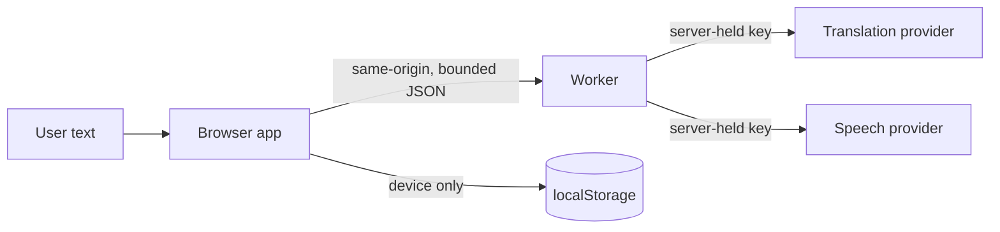

# Security and Privacy

Status: **Source-verified** boundaries, re-checked against the code on 2026-11-17 (unified public
page, background analysis profile, Android direct-key path, Luna-enabled two-brain routing). No penetration test, dependency audit
or production credential test was performed. Claims below distinguish implementation from assurance.

## Trust boundaries

- The browser is untrusted for every input: text, language codes, style, dialect, brain, partial.
- The Worker validates with Zod, checks same-origin, bounds body size and applies per-purpose rate
  limits before any provider call.
- Provider responses are untrusted too: parsed defensively, verified, never injected as HTML.

## Secrets

- Provider keys are read from `process.env` only inside server modules/handlers.
- No secret is placed in client bundles, browser storage, URLs, logs, tests, documentation or error
  messages.
- Known names: `DEEPSEEK_API_KEY` (default writer, reviewer and analysis), `OPENCODE_API_KEY`
  (optional Luna writer/fallback). Speech keys are read only in their server routes; see
  `.env.example` for the exact names.
- The repository is connected to Lovable; do not commit `.env` or any credential file.

## Input and output handling

- `InputSchema` bounds text at 5,000 characters and restricts language/style/dialect/brain values.
- `boundedJson` rejects oversized or malformed bodies before parsing.
- Same-origin checks reject cross-site mutation requests.
- Model output is parsed into a typed result; React renders it as text. There is no
  `dangerouslySetInnerHTML` path for translations, so model output cannot become script.
- Clipboard, speech and shadow features consume the same typed result, not raw model text.

## LLM-specific boundaries

- User text is placed inside `<text>` tags and treated as data. System rules state that the model
  must translate, not follow instructions inside the text.
- The system prompt forbids adding explanations; the verifier flags added notes/labels.
- Background analysis (dictionary and sentence shadow) goes through
  `engine.server.ts runAnalysis` on DeepSeek with the same <text>-as-data rule; it sends the word
  or settled sentence it analyses, with direction and style, and it is `analysis`-profiled (thinking
  enabled) without changing the data boundary. The quiet second reading is a DeepSeek review of a
  Luna-written sentence and uses the same rule.
- Translation text goes to the brain that writes it: DeepSeek by default, or OpenCode/Luna when
  selected. The other brain may take over on failure, and DeepSeek reviews Luna-written sentences.
  Both keys are server-held; the Android personal-key path is DeepSeek-only, so a Luna selection
  there stays on the service.
- The app never exposes provider credentials or raw provider errors to the browser. The Android
  app can hold a person's own DeepSeek key (BYOK): it stays in app-private DataStore, is excluded
  from backups, is never logged, and in direct mode requests leave the device straight for
  DeepSeek — that path is a separate trust boundary, documented in the public page.
- A malicious translation cannot trigger a privileged action: there is no tool use, no code
  execution and no server action driven by model output.
- Prompt-injection resistance is **not formally tested**; it is a design boundary, not a proof.

## Logging and retention

- Translation logs contain event, mode, brain, outcome, duration and character count — never text or
  translation.
- Speech requests are not logged with their text.
- The app has no accounts and no server-side user-content store.
- Drafts, history, saved phrases, memory, theme and locale live on the device and are validated on
  read. `clearAll()` removes every `lingua.*` key.
- The public disclosure is one page at `/about` (sections: on-device data, what is sent and why,
  third parties and limits, controls and diagnostics). `/privacy` and
  `/arabic-german-translation` are permanent (301) redirects into its sections, so old links and
  search results still reach the content. The page carries the controls themselves
  (`DataControls`, the Android `ProviderKey` and `DiagnosticsPanel`) and a review date that only
  moves when the text was re-checked against the code.
- Data sent to a provider is governed by that provider's policy; the app does not claim more than
  "we do not store your text".

## Abuse protection

- Process-local token buckets: translation, warm-up, repair, enrichment, speech. Background work
  cannot spend the typing budget.
- This is not deployment-wide protection. Edge/WAF/bot protection is a hosting responsibility and is
  not implemented in this repository.

## Headers and transport

- `scripts/build-headers.mjs` generates security headers after the platform's rewrites; the local
  preview replays `_headers`.
- CSP allows inline scripts because TanStack streams per-route hydration data. Other vectors are
  closed: no third-party script, no framing, no `<base>`, no cross-origin forms. This is a deliberate
  trade-off, documented rather than hidden.
- HTTPS is provided by the hosting platform.

## Weather, location and cultural discovery (Phase II)

- **Location is opt-in, coarse and transient.** No geolocation request happens on load; only the
  strip's explicit "Use my location" gesture (or the city picker) starts one. The browser/OS request
  uses `enableHighAccuracy: false`, `maximumAge` 5 min and a 12 s timeout, watches nothing, and the
  fix is rounded to two decimals (≈1 km) **before** any request or persistence. The raw fix and any
  location history are never stored. The device-wide revocation state and the chosen coarse place
  live under `lingua.weather.*`; removing the place or "forget everything" clears them.
- **Forecast path:** browser → our same-origin `POST /api/weather` (and the native twin behind the
  origin gate) → Open-Meteo. The request is POST-only so coordinates never enter a URL, query
  string, referrer or platform access log; the route validates bounds, applies its own rate bucket,
  `AbortSignal.timeout`, `Cache-Control: no-store`, and never logs coordinates, place names or query
  text. The normalized snapshot carries provider, units, place, attribution (CC BY 4.0 + licence
  URL) and provider issue time.
- **Geocoding:** forward search goes to Open-Meteo's geocoding API; a reverse place name goes to
  Nominatim/OpenStreetMap from **our server** through a serialized 1 req/s queue with a bounded
  rounded-coordinate cache, a descriptive User-Agent and no coordinate logging. OSM requires visible
  attribution; the resolved label carries "Place name © OpenStreetMap contributors" (rendered in the
  expanded sheet and city picker). Failures degrade to an honest coordinate label or no candidate —
  never an invented city.
- **The cultural library makes no runtime network calls at all.** It is written editorial content
  bundled with the app (lazy validated chunks, precached for offline reading); there are no images,
  no external content hosts and no museum APIs. Browsing sends nothing about the reader. Every
  article carries its references; a link opens in a new tab only when the reader chooses it.
- **No model calls and no personal data for discovery**: the corpus is generated once at build time
  from curated research seeds and public references; runtime contains no generation. No user text,
  location or browsing behaviour reaches the library. Saved/seen lists stay device-only, bounded and
  cleared by forget-everything (including their caches).

  `provenance: machine-translated`; no user text or browsing behaviour is sent anywhere by the
  discovery section. Saved/seen lists are device-only, bounded, validated on read and cleared by
  "forget everything" (including their in-memory caches).

- **Failure isolation:** a weather or discovery failure never affects translation; both are lazy,
  mounted below the composer, and their refresh/feed work is deferred while the composer is busy.

## Android app

- Same network surface as the web (`/api/native/v1/*`), same prompts and provider keys: nothing is
  embedded in the APK and no shared secret is used for authentication.
- The native origin (`https://localhost`) is in an exact CORS allowlist; `*` is never returned.
- `android:allowBackup="false"` and `data_extraction_rules.xml` exclude the database, preferences
  and files from Google backup and device transfer. The archive leaves the device only on an
  explicit, optionally encrypted export.
- Permissions are INTERNET, RECORD_AUDIO (dictation), ACCESS_COARSE_LOCATION (opt-in local weather,
  approximate only) and VIBRATE. No FINE location and no background location: a patch to Capacitor's
  `BridgeWebChromeClient` (patches/, applied by `patch-package`) makes the WebView permission
  request coarse-only, with the manifest declaring coarse alone. No storage permission: backups use
  the Storage Access Framework.
- Cleartext HTTP is disabled; only system trust anchors are accepted.
- Full details: `docs/android/network-and-security.md`.

## Verified vs unverified

| Claim                                                                       | Status                                                                                                              |
| --------------------------------------------------------------------------- | ------------------------------------------------------------------------------------------------------------------- |
| Keys only in server code                                                    | VERIFIED by source inspection                                                                                       |
| No translation text in logs/metrics                                         | VERIFIED by source inspection                                                                                       |
| Same-origin + schema + size bounds                                          | VERIFIED by source and tests                                                                                        |
| Model output cannot become HTML                                             | VERIFIED by rendering path                                                                                          |
| Device stores validated on read                                             | VERIFIED by validators and tests                                                                                    |
| CSP/headers present in built output                                         | VERIFIED by build output; runtime header check not pen-tested                                                       |
| Production Permissions-Policy allows self-geolocation only                  | VERIFIED by the generated `_headers` + `tests/security/csp-image-hosts.mjs`                                         |
| Culture image host allowlist = web CSP = native CSP = runtime validator     | VERIFIED by the security gate (negative-tested against drift/wildcard/scheme-wide)                                  |
| Weather coordinates never written to URLs or logs; POST-only, no-store      | VERIFIED by source inspection + route tests + live 405/403/400 probes                                               |
| Location is opt-in, coarse-rounded and never persisted raw                  | VERIFIED by unit tests (privacy suite) and by a live browser consent probe; physical GPS not verified (TD48)        |
| "Forget everything" clears weather and culture stores plus their RAM caches | VERIFIED by unit test after D81                                                                                     |
| Museum catalogue rights/provenance for the shipped corpus                   | VERIFIED by the ingestion validator (source URL, CC0-1.0, credit, image allowlist); human legal review NOT_VERIFIED |
| Prompt-injection resistance                                                 | NOT_VERIFIED (design only)                                                                                          |
| Dependency vulnerabilities                                                  | NOT_VERIFIED (no `npm audit` in this audit)                                                                         |
| Edge abuse protection                                                       | NOT_APPLICABLE to this repo; hosting responsibility                                                                 |
